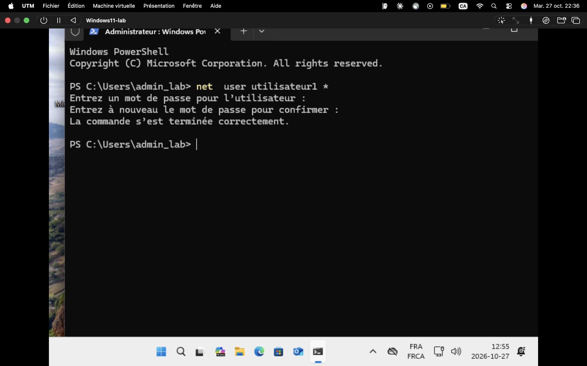
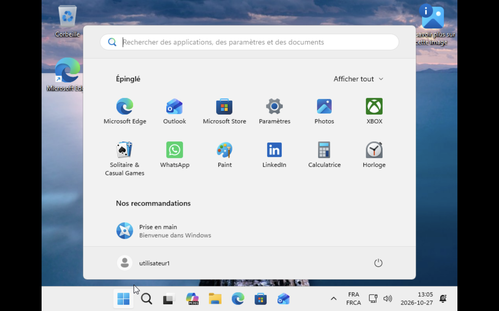

# INC-001 — Réinitialisation de mot de passe (utilisateur1)

- **Date :** 2026-10-27
- **Environnement :** VM Windows 11 (Arm64, UTM), compte local
- **Priorité :** P3 (un utilisateur bloqué, contournement impossible, aucun impact sur les autres)
- **Catégorie :** Compte

## Symptôme rapporté par l'utilisateur
« Je n'arrive plus à ouvrir ma session, j'ai oublié mon mot de passe. »

## Diagnostic
1. Vérification de l'identité du demandeur avant toute modification → identité confirmée (scénario de laboratoire).
2. Vérification que le compte existe et est actif (`net user utilisateur1`) → le compte existe et n'est pas désactivé.
3. Exclusion d'un verrouillage de compte → le compte n'est pas verrouillé, le problème vient du mot de passe seulement.

## Cause
Mot de passe oublié par l'utilisateur.

## Résolution
1. Ouverture de PowerShell en tant qu'administrateur (compte `admin_lab`).
2. Exécution de la commande `net user utilisateur1 *` (le mot de passe saisi ne s'affiche pas à l'écran).
3. Saisie puis confirmation d'un nouveau mot de passe temporaire → « La commande s'est terminée correctement ».

## Vérification avec l'utilisateur
Ouverture de session avec `utilisateur1` et le nouveau mot de passe : la connexion réussit et le bureau s'affiche.

## Prévention / à retenir
- Toujours vérifier l'identité de l'utilisateur avant de réinitialiser un mot de passe.
- Communiquer le mot de passe temporaire par un canal sécurisé et demander à l'utilisateur de le changer dès la première connexion.
- Dans un environnement d'entreprise, proposer la réinitialisation en libre-service (SSPR) pour réduire ce type de ticket.
- À ajouter à la base de connaissances : procédure de réinitialisation d'un mot de passe local.

## Temps total : 10 min
