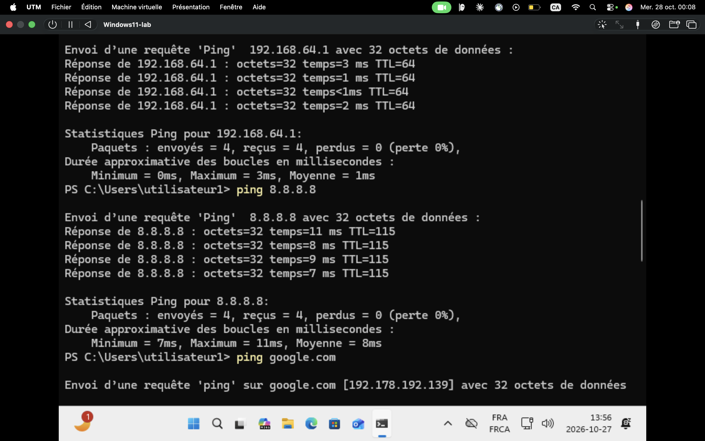
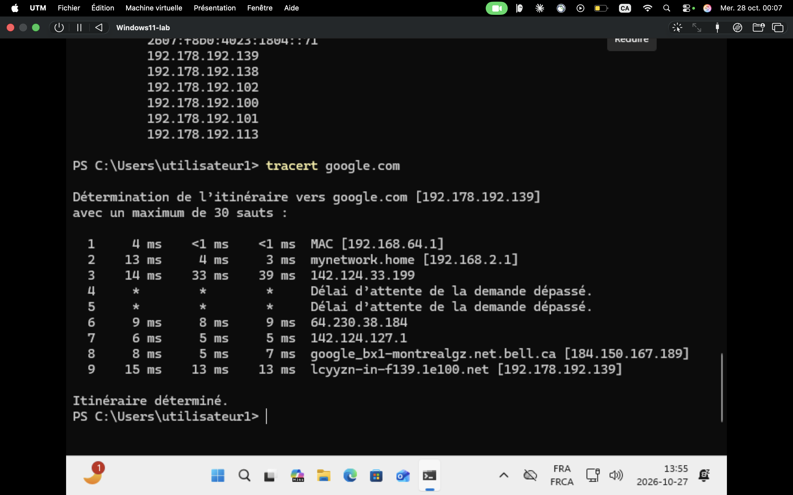

# INC-002 — « Internet ne fonctionne pas » : diagnostic réseau couche par couche

- **Date :** 2026-10-27
- **Environnement :** VM Windows 11 (Arm64, UTM), carte Red Hat VirtIO Ethernet, DHCP
- **Priorité :** P3 (scénario de laboratoire, un seul poste concerné)
- **Catégorie :** Réseau

## Symptôme rapporté par l'utilisateur
« Internet ne marche pas sur mon poste. »

## Diagnostic
On avance du plus proche au plus loin, pour isoler la couche en cause.

| # | Test | Ce qu'il vérifie | Résultat |
|---|------|------------------|----------|
| 1 | `ipconfig /all` | Configuration IP reçue | IPv4 `192.168.64.4`, masque `255.255.255.0`, passerelle `192.168.64.1`, DNS `192.168.64.1`, DHCP actif (bail de 2 h) |
| 2 | `ping 127.0.0.1` | Pile réseau de la machine | 4/4 reçus, 0 % de perte |
| 3 | `ping 192.168.64.4` | Carte réseau de la VM | 4/4 reçus, 0 % de perte |
| 4 | `ping 192.168.64.1` | Passerelle (réseau local) | 4/4 reçus, moyenne 1 ms |
| 5 | `ping 8.8.8.8` | Accès Internet par adresse IP | 4/4 reçus, moyenne 8 ms |
| 6 | `ping google.com` | Résolution DNS + Internet | Nom résolu en `192.178.192.139`, 3/4 reçus (1 délai dépassé, perte 25 %) |
| 7 | `nslookup google.com` | Serveur DNS | Réponse obtenue (adresses IPv4 et IPv6) |
| 8 | `tracert google.com` | Chemin vers la destination | Destination atteinte en 9 sauts |

### Lecture du tracert
- Saut 1 : `192.168.64.1` (passerelle virtuelle UTM).
- Saut 2 : `mynetwork.home` (`192.168.2.1`), le routeur de la maison.
- Saut 3 : un routeur du fournisseur d'accès.
- Sauts 4 et 5 : « Délai d'attente dépassé » (astérisques). Ce n'est pas une panne : certains routeurs ne répondent pas aux requêtes ICMP, et le trafic continue de passer, puisque les sauts suivants répondent.
- Saut 9 : destination Google atteinte.

## Cause
Aucune panne trouvée : tous les niveaux répondent (pile locale, carte, passerelle, Internet par IP, DNS). Le seul écart est une perte ponctuelle de 1 paquet sur 4 vers google.com, sans lien avec une défaillance de configuration (le ping suivant et le tracert aboutissent).

## Résolution
Aucune correction nécessaire. Le poste a un accès Internet fonctionnel. Dans un vrai ticket, on demanderait à l'utilisateur de décrire plus précisément le symptôme (quel site, quel navigateur, quel message d'erreur), car le problème se situe probablement au niveau de l'application ou d'un site précis.

## Vérification avec l'utilisateur
Confirmer que le site ou l'application concerné s'ouvre. Si le problème revient, refaire `ping google.com` plusieurs fois et noter la fréquence de la perte.

## Arbre de diagnostic réutilisable
1. `ipconfig /all` : adresse IP valide (pas de `169.254.x.x`) ? passerelle et DNS présents ?
   - `169.254.x.x` → le DHCP ne répond pas : vérifier la connexion, `ipconfig /renew`.
2. `ping 127.0.0.1` échoue → problème de pile réseau/pilote de la carte.
3. `ping <passerelle>` échoue → problème local (câble, Wi-Fi, carte, VLAN).
4. `ping 8.8.8.8` échoue (passerelle OK) → problème entre le routeur et Internet (fournisseur d'accès, routeur).
5. `ping 8.8.8.8` OK mais `ping google.com` échoue → problème DNS : `nslookup`, `ipconfig /flushdns`, vérifier l'adresse du serveur DNS.
6. Tout OK → problème applicatif (navigateur, proxy, pare-feu, site précis).

## Prévention / à retenir
- Toujours tester du plus proche au plus loin pour savoir où chercher.
- Mémoriser la valeur de `ipconfig /all` (IP, passerelle, DNS) avant de dire que « le réseau est en panne ».
- Les astérisques dans un `tracert` ne signifient pas automatiquement une panne.
- À ajouter à la base de connaissances : l'arbre de diagnostic ci-dessus.

## Temps total : 20 min
