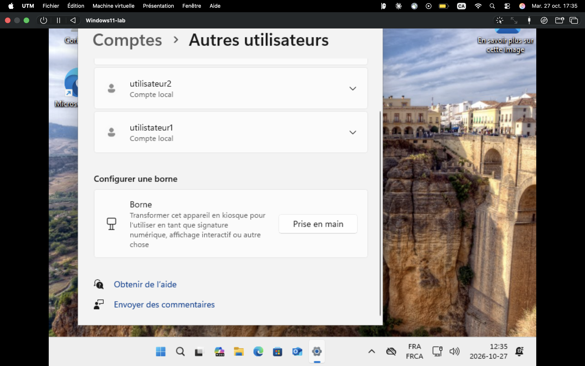

# Journal du laboratoire de soutien TI

Une entrée par séance : date, durée, ce que j'ai fait, problèmes rencontrés, ce que j'ai appris.

---

## 2026-10-27 — Phase 1 : machine virtuelle Windows 11

**Durée approximative :** 3 h

### Ce que j'ai fait
- Libéré de l'espace disque sur mon Mac (de quoi avoir environ 52 Go libres avant de créer la VM).
- Installé **UTM** (virtualisation pour Mac Apple silicon).
- Téléchargé l'ISO officiel de **Windows 11 Arm64** sur le site de Microsoft (environ 8 Go).
- Créé la VM `Windows11-lab` dans UTM : mode « Virtualiser », 4 Go de mémoire, 40 Go de disque.
- Installé Windows 11 sans clé de produit et configuré le compte administrateur local `admin_lab`.
- Créé deux comptes locaux standard depuis Paramètres → Comptes → Autres utilisateurs (`utilisateur2` et `utilisateur1`, voir problème n° 3).

### Problèmes rencontrés et solutions
1. **Manque d'espace disque.** Le Mac n'avait pas assez d'espace libre pour une VM. Solution : suppression de fichiers inutiles (installateurs, archives en double, copies d'applications) dans le dossier Téléchargements, après vérification des doublons.
2. **Mauvais ISO.** La page de Microsoft proposait d'abord l'Assistant d'installation et un ISO **x64**, incompatibles avec un processeur Arm. Solution : utiliser le lien dédié aux fichiers **Arm64**.
3. **Faute de frappe dans un nom de compte.** Le compte a été créé sous le nom `utilistateur1` au lieu de `utilisateur1`. À corriger : supprimer et recréer le compte avec le bon nom (les noms de compte ne se renomment pas facilement depuis Paramètres).

### Ce que j'ai appris
- La différence entre les architectures x64 et Arm64, et pourquoi elle compte pour une machine virtuelle.
- Comment créer une VM et des comptes locaux standard dans Windows 11.
- Vérifier les noms saisis avant de valider : une petite faute peut créer un compte inutilisable en entreprise.

### Preuves
- Capture d'écran de la page Paramètres → Comptes → Autres utilisateurs (`docs/screenshots/2026-10-27-comptes.png`).

### Prochaines étapes
- Corriger le nom du compte `utilistateur1`.
- Phase 2 : réinitialiser un mot de passe, créer un dossier partagé avec permissions, tester le réseau (`ipconfig /all`, `ping`, `nslookup`).
- Rédiger la première fiche d'incident (`docs/incidents/`).
